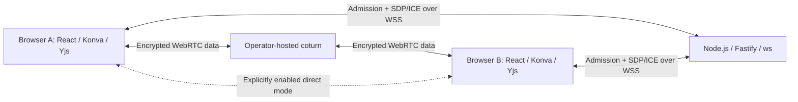

# Beebo Board

A private, open-source space to think and learn together. Beebo is a browser-based collaborative whiteboard for tutoring, study groups, and small teams of **up to eight people**.

**Status: initial implementation for review.** Local editing and encrypted WebRTC collaboration are implemented. This is not a production-hardened classroom service or a formally recognized Digital Public Good.

## Why Beebo exists

Collaborative learning should be accessible without a subscription, a mandatory account, or sharing classroom work with advertising systems. Beebo supports **SDG 4: Quality Education**, particularly equitable access and inclusion, through portable learning materials, small-group activities, keyboard editing, and a low-bandwidth mode.

The software is open source. Learners' boards remain their content and are not published as open data.

## Implemented

- Pen, rectangles, ellipses, arrows, text, and sticky notes; selection and movement.
- Pan with middle-mouse drag or the Hand tool; zoom, local undo/redo, editable board titles, and an accessible Objects panel.
- Cursor tool (V) moves every element. Select several at once with Shift/Ctrl+click, by dragging a box on empty board, or with Ctrl/⌘ A; the group moves, resizes, nudges with arrow keys, and deletes together. Paste a picture (Ctrl/⌘ V) or drop an image file to add it as its own object: it is shrunk and re-encoded in the browser so boards stay small, can be resized from its corners, described for screen readers, and copied back out (Ctrl/⌘ C). Frame (F) adds a background area (white or any color) that carries the objects inside it and exports to PNG from its toolbar. Text (T) and Sticky note (N) are typed right on the board; selecting any object shows handles to resize it and a toolbar for font, size, bold, alignment, color, and thickness. The Pen (P) flyout holds the brushes, sizes, colors, and two erasers: Object eraser (E) removes whole objects along its path, and Partial eraser (X) cuts away only the part of a pen or highlighter line it touches.
- Versioned JSON import/export and PNG export of the visible view.
- Opt-in personal-board storage in IndexedDB; explicit restore and deletion.
- Think–Pair–Share and Know–Wonder–Learn activity templates.
- Browser-encrypted document updates and cursors over WebRTC data channels.
- Private invitations, authenticated signaling admission, eight-participant room limits, and expiring rooms.
- TURN-only connections by default. Direct connections require both operator enablement and the creator's explicit choice.
- Pinned dependencies, a license gate, CycloneDX SBOM, and third-party notices.

## Run locally

Use **Node.js 22.12 or newer** and npm. The lockfile was generated with npm 11.10.0; dependency lifecycle scripts are disabled in `.npmrc`.

```sh
npm ci
npm run dev
```

Open **http://127.0.0.1:5173**. The client uses Vite; the signaling service listens on port 3001. `npm run dev` starts both. The canvas works without TURN, accounts, or an Internet connection after the page has loaded; the application shell is not yet cached for offline launches.

For a production build served by the Node process:

```sh
npm run build
npm start
```

Open **http://127.0.0.1:3001**. For deployment beyond localhost, configure HTTPS/WSS, the exact allowed origin, and your TURN service. See [deployment instructions](docs/DEPLOYMENT.md).

### Collaboration setup

Copy `.env.example` to `.env` and provide `TURN_URLS` and `TURN_SECRET` for a coturn service using its shared-secret authentication mode. Both `npm run dev` and `npm start` load `.env`. Open **Share board**, enter a display name, and create a private room. Share the complete invitation privately; its fragment contains the room key.

Without TURN, default room creation stays unavailable. To test direct connections explicitly on your own machine, add this to `.env`, restart the server, and select **Allow direct connections** when creating the room:

```dotenv
DIRECT_CONNECTIONS_ENABLED=true
```

Direct connections can expose participants' IP addresses to one another. Joining an invitation accepts the room creator's connection policy. No automatic downgrade from relay-only to direct connections occurs.

## Architecture



The browser owns the document, rendering, encryption, and export. Yjs maps store shape properties; a shared array stores stacking order. UI state stays local. Cursors are transient messages rather than document history. A small native WebRTC adapter exchanges state vectors, updates, and presence in bounded encrypted chunks.

The signaling service holds temporary room admission verifiers and membership in memory. It never receives the invitation encryption key or board content. It issues short-lived TURN credentials only after successful room admission. Eight peers form a mesh of 28 pairwise connections, including when TURN relays them.

See [architecture and protocol](docs/ARCHITECTURE.md) for encryption, limits, conflict behavior, and trust boundaries.

| Layer           | Technology                                                | Declared upstream license                               |
| --------------- | --------------------------------------------------------- | ------------------------------------------------------- |
| Interface       | React, React DOM                                          | MIT                                                     |
| Drawing         | Konva, react-konva                                        | MIT                                                     |
| Shared document | Yjs                                                       | MIT                                                     |
| Signaling       | Fastify, ws                                               | MIT                                                     |
| Language        | TypeScript                                                | Apache-2.0                                              |
| Build           | Vite 7, esbuild, Rollup                                   | MIT with additional permissive bundled notices          |
| Tests           | Node test runner, playwright-core, existing local browser | Driver: Apache-2.0; external browser audited separately |
| External relay  | coturn                                                    | BSD-3-Clause; not bundled                               |

License scope and review details are in [LICENSE_POLICY.md](docs/LICENSE_POLICY.md), [THIRD_PARTY_NOTICES.txt](THIRD_PARTY_NOTICES.txt), [sbom.cdx.json](sbom.cdx.json), and [license evidence](docs/license-audit.json).

## Privacy and safe use

- No telemetry, third-party fonts, remote asset CDNs, or account requirement.
- Personal saving is off by default. Enabling it saves only your personal board on this browser/device. It is not encrypted at rest. Shared rooms disable automatic personal saving.
- Browser-held room content uses AES-256-GCM in addition to WebRTC transport encryption. The shared invitation secret is separated into encryption and admission material using HKDF-SHA-256.
- Anyone with the invitation can read, edit, export, and retain the board. Treat invitations as sensitive. There are no teacher-only permissions, kick/ban controls, or key rotation yet.
- Static hosting, signaling, and TURN operators can observe IP addresses and connection metadata. Encryption does not hide traffic patterns or protect against a compromised application host or endpoint.
- Rooms expire after two hours; empty rooms expire after ten minutes. Closing every participant's tab loses the live shared state unless someone exported it. Server restarts erase rooms. A browser reload requires joining again and an online peer to restore shared content.
- Export before closing your tab. There is no cloud backup or server-side board recovery.

Read [PRIVACY.md](docs/PRIVACY.md) and [SECURITY.md](SECURITY.md) before hosting sensitive sessions. The current all-editor model is intended for trusted small groups, not public unmoderated rooms.

## Accessibility and bandwidth

The Objects panel supports adding notes, selecting objects, editing text and coordinates, and deleting without dragging. Keyboard shortcuts are listed in Help; focused controls and dialogs use native keyboard behavior. Reduced-motion preferences are respected. Low-bandwidth mode throttles cursors to five updates per second and reduces pen samples; completed strokes are synchronized after pointer release.

**WCAG 2.2 AA is a target, not a conformance claim.** Manual screen-reader reviews, touch/usability testing, contrast assessment, and measurements on constrained networks remain in the [roadmap](docs/ROADMAP.md).

## Checks and review

```sh
npm run check
npm run test:browser
```

`check` runs TypeScript checks, unit/integration tests, the license gate, and the production build. Browser smoke tests start their own local production server, use an already-installed Microsoft Edge, and save screenshots to `test-results/`. No browser is downloaded. Set `BROWSER_EXECUTABLE` to an existing compatible Chromium browser if necessary. Build before running browser tests.

After a reviewed dependency change:

```sh
npm run licenses:generate
npm run licenses:check
```

The gate covers every locked npm package's declared license, including optional dependencies, and inspects available installed license/notice files. It does not certify every source file, native binary, operating-system package, browser, or hosting provider. See the policy for platform-specific inspection gaps.

Follow [the manual review checklist](docs/REVIEW.md) to evaluate behavior and the live TURN path.

## Digital Public Goods alignment

Beebo is being designed to align with the [DPG Standard](https://www.digitalpublicgoods.net/standard). Formal recognition has not been obtained. The [evidence matrix](docs/DPG_COMPLIANCE.md) distinguishes implemented safeguards from remaining work, including ownership confirmation, applicable-law review, harassment protections, and independent accessibility/security assessment.

## Contributing and ownership

Read [CONTRIBUTING.md](CONTRIBUTING.md) and [AGENTS.md](AGENTS.md). All initialization and subsequent changes go through PRs, on distinct feature or fix branches. The repository steward is the account managing [DTravkov/beebo-board](https://github.com/DTravkov/beebo-board); formal project governance is documented in [GOVERNANCE.md](docs/GOVERNANCE.md).

Project code and original documentation are licensed under [Apache-2.0](LICENSE). Contributors retain their copyrights. Third-party licenses and notices remain applicable to their respective components.
