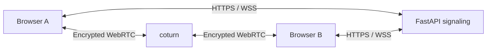

# Architecture

Beebo targets groups of up to eight participants. React renders the UI, Konva draws the canvas, Yjs holds shared content, and native WebRTC data channels synchronize peers. FastAPI and Uvicorn handle admission and signaling. coturn relays traffic by default.

Production Caddy serves static frontend files and proxies API and signaling requests to FastAPI. FastAPI and coturn never hold the invitation encryption key or a plaintext board. Explicit direct mode connects browsers without requiring a relay; no public STUN service is built in.

## Code boundaries

| Location                                           | Responsibility                                             |
| -------------------------------------------------- | ---------------------------------------------------------- |
| `frontend/src/App.tsx`, `frontend/src/components/` | Workspace composition and shared UI controls               |
| `frontend/src/features/board/`                     | Board lifecycle, local saving, Objects panel, text dialog  |
| `frontend/src/features/canvas/`                    | Pointer interaction, shape rendering, inline text, cursors |
| `frontend/src/features/room/useServerConfig.ts`    | Room capability loading and request cleanup                |
| `frontend/src/shared/board.ts`                     | Portable schema, validation, resource limits               |
| `frontend/src/lib/document.ts`                     | Yjs state and local undo                                   |
| `frontend/src/lib/crypto.ts`                       | Key derivation and payload encryption                      |
| `frontend/src/lib/room.ts`                         | Signaling client, peer mesh, synchronization               |
| `frontend/src/lib/storage.ts`                      | Explicit browser-local persistence                         |
| `backend/src/main.py`                              | FastAPI app, middleware, lifecycle, process entry          |
| `backend/src/config.py`                            | Pydantic environment settings and TURN secret loading      |
| `backend/src/rooms/`                               | Room domain, admission, repository, HTTP creation          |
| `backend/src/signaling/`                           | WebSocket adapter, peer routing, TURN credentials          |
| `backend/src/system/`                              | Public configuration and health                            |
| `backend/src/shared/`                              | Shared dependencies, security headers, origin/IP policy    |
| `backend/tests/`                                   | Python tests mirroring server features                     |
| `frontend/tests/`                                  | Document, security, signaling, and browser behavior tests  |

See [the backend guide](../backend/README.md) for the feature boundaries, bootstrap lifecycle, and an end-to-end room-creation reading order.

Frontend feature modules use direct imports. Canvas types and geometry are separate from the renderer; shape content, image decoding, inline text, and remote cursor animation have their own components. The board hooks own document subscriptions and saving, while the keyboard text dialog owns its uncommitted draft. `App` coordinates these features through explicit props and actions.

Pen and highlighter widths are stored in board pixels: an 8 px stroke renders at 8 screen pixels at 100% zoom, 4 at 50%, and 16 at 200%. Brush previews follow the same scale. Selection hit areas retain a minimum screen size so thin strokes remain easy to select.

Canvas layers refresh their bitmap density when browser zoom or display density changes. Headers and object controls wrap on smaller viewports, the navigation rail scrolls on short screens, and floating editors stay within the visible board. Browser smoke tests cover narrow and landscape layouts, fractional pixel densities, and density changes without reloading.

Sharing failures render as persistent alerts inside the Share dialog, including creation failures before an invitation exists. Retrying clears the previous error. Sharing notifications also render inside the modal so they remain visible in the browser's dialog top layer.

## Document and storage

A board has three Yjs roots: `objects` maps shape IDs to independently editable properties, `order` stores stacking order, and `metadata` stores the title. Selection, viewport, tool settings, and dialogs stay local. Cursors use transient presence messages. Undo tracks local edits and excludes remote transactions.

Remote cursor positions interpolate on the cursor layer between received updates. Animation duration follows the arrival interval, bounded to 70–200 ms, and each new target starts from the displayed position. The animation stops on arrival or when the peer disappears; smoothing adds no presence traffic or shared document state.

Yjs resolves concurrent property writes deterministically. Text is stored as a whole-string property, so simultaneous typing in one note does not merge character by character. Joining peers exchange state vectors and missing updates. There is no server replica or durable shared room; at least one peer must retain the board for others to recover it.

Portable `.beebo.json` files contain format/version, title, and ordered shapes, without keys, presence, or CRDT history. Imports validate before replacing content. IndexedDB holds one explicitly restorable snapshot; personal autosaving is opt-in and shared-board saving requires a button click. PNG is a visual export, not an editable backup. There is no offline application-shell cache.

## Admission and encryption

1. The creator generates a random room UUID and 32-byte invitation secret in the browser.
2. HKDF-SHA-256 derives separate AES-256-GCM encryption and admission keys using the room ID as salt.
3. Room creation sends the ID, connection policy, and SHA-256 admission-token verifier to FastAPI. Invitations keep the ID and secret in the URL fragment.
4. A WebSocket must supply its admission token within five seconds. After verification, FastAPI returns peers, room policy, expiry, and one-hour TURN credentials.
5. Only members of the same room can exchange SDP/ICE signaling. A room's connection policy cannot change. Default relay mode requires TURN; direct mode requires operator enablement and the creator's explicit choice.

This authenticates a shared invitation, not individual identities. Every invitation holder is an editor. FastAPI can observe membership and connectivity metadata; the host can also replace served JavaScript. See [SECURITY.md](../SECURITY.md).

## Synchronization and bounds

Each peer pair uses one ordered, reliable `beebo-v1` data channel. State vectors, document updates, and throttled presence are sent as encrypted chunks of at most 12,000 plaintext bytes. Each chunk carries a version, message kind, random message ID, index, and count; AES-GCM uses a fresh 96-bit nonce and authenticates the room ID. The mesh has 28 connections at eight participants, including in TURN mode.

Sends and receives are serialized. Backpressure pauses sending and disconnects persistently slow peers. Received updates are applied to an isolated candidate document and validated before reaching live state. These bounds reduce resource abuse without establishing measured production capacity:

| Resource                                   | Limit                                               |
| ------------------------------------------ | --------------------------------------------------- |
| Participants / rooms                       | 8 per room / 250 per process                        |
| Objects / stroke coordinates               | 1,000 / 8,000 numeric values                        |
| Import, update, or accepted shared history | 2,000,000 bytes                                     |
| Queued payload / incomplete messages       | 4,000,000 bytes per direction per peer / 4 messages |
| Signaling payload / HTTP body              | 32,768 / 4,096 bytes                                |
| HTTP room requests and socket upgrades     | 60 per minute per observed IP                       |
| WebSocket signaling                        | 100 messages per 10 seconds per connection          |
| Room / empty-room lifetime                 | 2 hours / 10 minutes                                |

TURN credential refresh, automatic reconnect, multi-instance signaling, teacher roles, revocation, and key rotation remain unimplemented. Larger groups require a different topology and measured relay bandwidth.
