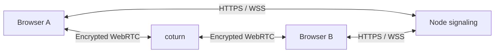

# Architecture

Beebo targets groups of up to eight participants. React renders the UI, Konva draws the canvas, Yjs holds shared content, and native WebRTC data channels synchronize peers. Fastify and `ws` handle admission and signaling. coturn relays traffic by default.

The production Compose profile places Caddy in front of Node for HTTPS. Node and coturn never hold the invitation encryption key or a plaintext board. Explicit direct mode connects browsers without requiring a relay; no public STUN service is built in.

## Code boundaries

| Location                           | Responsibility                                            |
| ---------------------------------- | --------------------------------------------------------- |
| `src/App.tsx`, `src/components/`   | Workspace, controls, canvas interaction                   |
| `src/shared/board.ts`              | Portable schema, validation, resource limits              |
| `src/lib/document.ts`              | Yjs state and local undo                                  |
| `src/lib/crypto.ts`                | Key derivation and payload encryption                     |
| `src/lib/room.ts`                  | Signaling client, peer mesh, synchronization              |
| `src/lib/storage.ts`               | Explicit browser-local persistence                        |
| `server/app.ts`, `server/index.ts` | Admission, quotas, configuration, static serving          |
| `scripts/dev.mjs`                  | Starts/stops the development server and Vite together     |
| `tests/`                           | Document, security, signaling, and browser behavior tests |

## Document and storage

A board has three Yjs roots: `objects` maps shape IDs to independently editable properties, `order` stores stacking order, and `metadata` stores the title. Selection, viewport, tool settings, and dialogs stay local. Cursors use transient presence messages. Undo tracks local edits and excludes remote transactions.

Yjs resolves concurrent property writes deterministically. Text is stored as a whole-string property, so simultaneous typing in one note does not merge character by character. Joining peers exchange state vectors and missing updates. There is no server replica or durable shared room; at least one peer must retain the board for others to recover it.

Portable `.beebo.json` files contain format/version, title, and ordered shapes, without keys, presence, or CRDT history. Imports validate before replacing content. IndexedDB holds one explicitly restorable snapshot; personal autosaving is opt-in and shared-board saving requires a button click. PNG is a visual export, not an editable backup. There is no offline application-shell cache.

## Admission and encryption

1. The creator generates a random room UUID and 32-byte invitation secret in the browser.
2. HKDF-SHA-256 derives separate AES-256-GCM encryption and admission keys using the room ID as salt.
3. Room creation sends the ID, connection policy, and SHA-256 admission-token verifier to Node. Invitations keep the ID and secret in the URL fragment.
4. A WebSocket must supply its admission token within five seconds. After verification, Node returns peers, room policy, expiry, and one-hour TURN credentials.
5. Only members of the same room can exchange SDP/ICE signaling. A room's connection policy cannot change. Default relay mode requires TURN; direct mode requires operator enablement and the creator's explicit choice.

This authenticates a shared invitation, not individual identities. Every invitation holder is an editor. Node can observe membership and connectivity metadata; the host can also replace served JavaScript. See [SECURITY.md](../SECURITY.md).

## Synchronization and bounds

Each peer pair uses one ordered, reliable `beebo-v1` data channel. State vectors, document updates, and throttled presence are sent as encrypted chunks of at most 12,000 plaintext bytes. Each chunk carries a version, message kind, random message ID, index, and count; AES-GCM uses a fresh 96-bit nonce and authenticates the room ID. The mesh has 28 connections at eight participants, including in TURN mode.

Sends and receives are serialized. Backpressure pauses sending and disconnects persistently slow peers. Received updates are applied to an isolated candidate document and validated before reaching live state. These bounds reduce resource abuse without establishing measured production capacity:

| Resource                                   | Limit                                               |
| ------------------------------------------ | --------------------------------------------------- |
| Participants / rooms                       | 8 per room / 250 per process                        |
| Objects / stroke coordinates               | 1,000 / 8,000 numeric values                        |
| Import, update, or accepted shared history | 2,000,000 bytes                                     |
| Queued payload / incomplete messages       | 4,000,000 bytes per direction per peer / 4 messages |
| Signaling payload / HTTP body              | 32,768 / 4,096 bytes                                |
| HTTP room requests and socket upgrades     | 60 per minute per observed IP                       |
| WebSocket signaling                        | 100 messages per 10 seconds per connection          |
| Room / empty-room lifetime                 | 2 hours / 10 minutes                                |

TURN credential refresh, automatic reconnect, multi-instance signaling, teacher roles, revocation, and key rotation remain unimplemented. Larger groups require a different topology and measured relay bandwidth.
